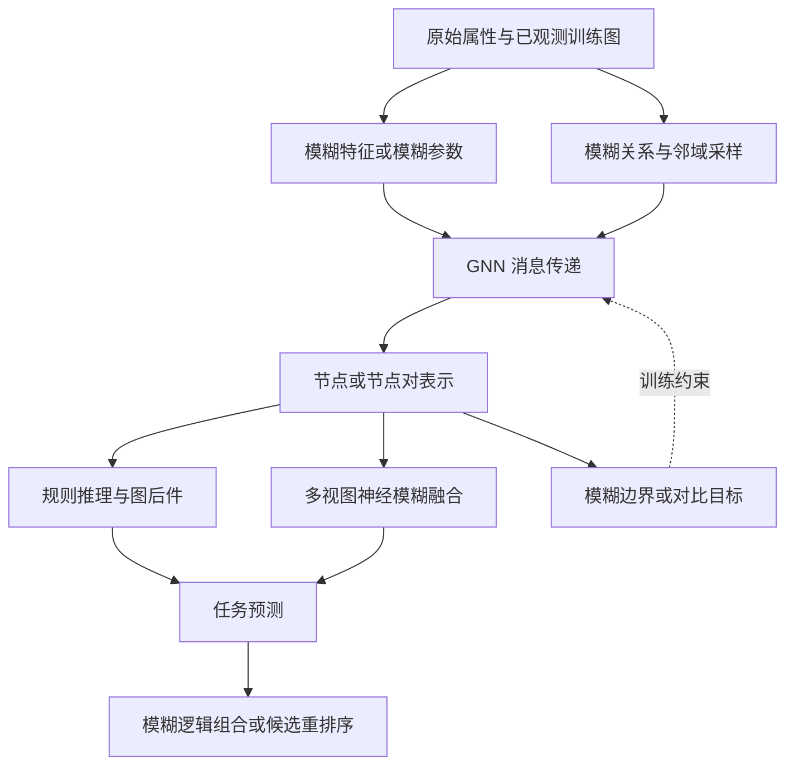

# 按方法原理理解模糊逻辑与 GNN

[返回总览](../README.md) · [静态图](static-graphs.md) · [动态图/时序图](dynamic-graphs.md) · [逐篇卡片](catalogue.md)

本分类是对已收录工作的整理，不表示原作者采用相同分类名称。主分类回答“模糊机制改变了哪一步”，任务类型作为独立维度。

## 一张图看融合位置

上图是可选作用位置示意，各论文只实现其中部分，不能把它当成任何单篇论文的结构图。非神经模糊链接指标可直接从训练图产生分数，绕过 GNN。

## A．参数、特征与表示模糊化

核心是把原本的确定向量或参数扩展为模糊表示，再设计传播与解模糊过程。代表：FuzzyGCN（P06）、FuzzyDGL（P05）、FL-GNN（P08）；HyperCFN（P15）进一步结合超图协同与对比学习。

需要区分：**对网络权重/偏置做模糊数建模**，与**把特征映射为多个隶属响应**不是同一种操作。二者也不等同于 dropout 或贝叶斯后验。具体依据见 [P06](catalogue.md#p06)、[P08](catalogue.md#p08)、[P15](catalogue.md#p15) 的一手来源。

## B．模糊关系驱动的采样与注意力

将节点间关系或节点—超边关系转成隶属度，用于挑选样本、分配邻域贡献。例如：FGAT/FNS（P01）改变负样本选择并改造聚合；DFS（P07）学习邻居隶属关系；FHATN（P14）分别处理顶点到超边和超边到顶点的聚合。

一般形式可以写为：

\[
m_u=\sum_{v\in\mathcal N(u)} a_{uv}\,\phi(h_v),\qquad
a_{uv}=\operatorname{Normalize}(\mu_{uv}).
\]

这是概念示意，不是上述论文的统一公式。普通 softmax 注意力也会输出连续权重；要称为模糊机制，还应说明模糊关系、隶属函数或模糊算子的定义及作用，不能仅给 attention 换名称。

## C．可学习规则、图后件与规则解释

这一类显式构造前件条件和规则后件。GFS-Node（P09）和 GFS-Edge（P02）让图模型承担后件学习；FireGNN（P11）用结构描述量形成可学习模糊规则；TSKG（P17）则用 GCN 优化模糊规则；FGF-GAT（P22）在知识图谱中以规则推理调节可靠性。

经典一阶 TSK 的示意是：

\[
r_k(z)=\prod_j\mu_{kj}(z_j),\quad
\bar r_k=\frac{r_k}{\sum_l r_l+\epsilon},\quad
f(z)=\sum_k\bar r_k\left(b_k+\theta_k^\top z\right).
\]

各论文可能采用不同的合取、前件生成和后件模型，不能把这个示意式替代作者公式。图后件甚至可能是一个神经网络；因此“有规则”不意味着全模型天然透明。需要同时评估规则数、激活覆盖、稳定性、可读性，以及屏蔽规则对输出的影响。

## D．神经模糊多视图融合

先用不同图编码器/视角得到表示，再通过神经模糊系统调节融合。普通图 LP 中可关注 AFGRL（P03）和 AFGNN（P04）。目前对这两条只核对一手摘要，尚不能断言其使用同样的 TSK、输入特征或时间协议。

针对这条路线，合理的消融包括：单视图、多视图线性融合、多视图 MLP/注意力融合、多视图模糊融合。否则多视图引入的信息增益可能被误写成模糊逻辑收益。

## E．模糊边界与训练目标

模糊逻辑也可改变表示空间的训练约束。ICML 2025 的模糊边界工作（P10）通过扩张与收缩边界处理局部小群和全局稀疏；其下游实验证据为节点分类和聚类。HyperCFN（P15）同时涉及对比学习与结构重建，可跨类阅读。

迁移到 LP 时，必须重新验证边预测；节点聚类改善不自动保证节点对排序改善。

## F．模糊语义、逻辑算子与知识推理

这是扩展方向，内部还应再分：

| 子路线 | 代表 | 模糊机制主要作用 | 与 Cora LP 的差别 |
|---|---|---|---|
| 语义隶属/嵌入 | AFS 层次 KG（P18）、FSKGE（P20） | 语义关系或时空元素模糊性 | 关系类型、时空字段和输入条件不同 |
| 逻辑真值组合 | FIT（P24）、UltraQuery（P23） | 用模糊算子组合关系投影/原子预测 | 主要评估复杂查询，不是普通节点对二分类 |
| 时序规则 | 时间分层与模糊规则（P21） | 关系谓词及时间约束 | 需要时间戳与时间划分 |
| 候选集处理 | ReDistLP（P19） | 模糊集合重排序 | 归纳 KG 补全；未必是 GNN 内部机制 |

FGF-GAT（P22）在任务上属于 KG，在机制上属于 C 类可学习规则与可靠性聚合。**知识图谱论文不能仅因标题包含 graph 就归为 GNN；有 GNN 的也不直接等同无类型图 LP。**

## G．非神经模糊图链接指标

SP 指标（P25）、多极 RMS（P26）、模糊路径强度（P27）、广义模糊超图 FLP（P28）与机器人 SP 应用（P29）直接由隶属关系、邻域或路径产生分数。它们与 GNN 的区别是没有相同意义的神经消息传递训练过程。

可将其作为结构评分对照，但应明示 Cora 上的隶属度如何构造、使用哪些训练信息，以及是否引入了额外数据。

## 三种量不要混用

- **模糊隶属度**：对象对某概念/关系的符合程度。
- **概率**：给定信息下事件发生的概率，需要相应概率模型或校准证据。
- **补全权重**：该候选对聚合的影响大小，可以只是启发式权重。

即便三者数值都在 0–1，也不自动等价。用模糊规则产生 NCNC 补全权重时，应说明它优化的是候选排序、可信程度还是消息贡献，避免在论证中互换概念。
